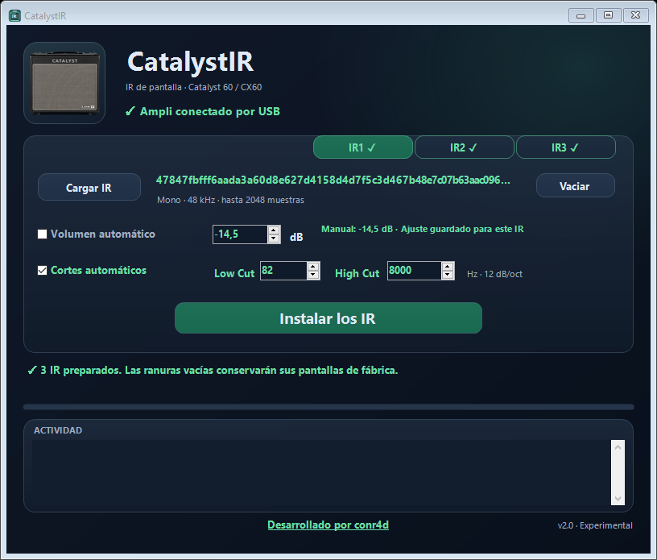

# CatalystIR 2.0 · Experimental

Desarrollado por **conr4d**. Carga hasta tres IR propios dentro del Catalyst mediante USB, para usarlos en la simulación de pantalla de auriculares, Direct Out y USB.



## Descargar y empezar

[**Descargar CatalystIR.exe**](https://github.com/conr4d86/CatalystIR/releases/download/v2.0.0-alpha.1/CatalystIR.exe) · [**Ver versiones y descargas**](https://github.com/conr4d86/CatalystIR/releases)

Descarga **CatalystIR.exe** desde la sección **Releases** de este repositorio. Es un solo ejecutable para Windows, con firmware base y bibliotecas integrados. No requiere instalar un plugin de audio en el PC ni inicia ejecutables auxiliares para la transferencia.

1. Cierra Catalyst Edit, conecta el ampli por USB y enciéndelo.
2. Abre CatalystIR y carga tus WAV en **IR1**, **IR2** o **IR3**. Basta con una ranura; puedes usar cualquier combinación.
3. Revisa el nivel y los cortes de cada IR. Los perfiles nuevos usan normalización automática y cortes de **80 Hz / 8 kHz**.
4. Baja el volumen y pulsa **Instalar los IR**. Mantén alimentación y USB hasta que termine.
5. Cuando aparezca **Apaga y enciende tu ampli**, reinícialo normalmente, sin pulsar botones. Mantén la app abierta para completar la activación.
6. Espera **IR guardados ✓** y prueba con auriculares a volumen bajo.

**Lee antes de instalar:** [instrucciones completas](docs/USO.md) y [recuperación del amplificador](docs/RECUPERACION.md).

## Lo que incluye

- Tres ranuras independientes: **IR1**, **IR2** e **IR3**.
- Volumen automático o manual y cortes Low Cut / High Cut por IR.
- Copia verificada de los 12 presets antes de cada transferencia.
- Almacenamiento de los IR en el firmware y recuperación de la selección guardada en el preset al arrancar.
- Inicio de la app con las ranuras vacías, conservando perfiles y copias. Permite instalar otra vez los mismos WAV.
- Una única instalación para el conjunto seleccionado. Una ranura vacía usa su simulación de fábrica en esa instalación.

**Cada instalación sustituye el conjunto completo.** Si quieres conservar un IR de la instalación anterior, vuelve a cargarlo en su ranura. Abrir la app con las ranuras vacías no borra nada del ampli.

## Compatibilidad y límites

Esta versión comprueba **Catalyst 60 / CX60 con firmware base 2.02**. No habilita por inferencia otros modelos ni versiones. Requiere Windows con .NET Framework 4.8 o posterior y el controlador USB del Catalyst funcionando.

Formato admitido: **WAV mono a 48 kHz, entre 1 y 2048 muestras**, PCM de 16/24/32 bits o float32. No convierte automáticamente estéreo, frecuencias distintas ni IR más largos.

Los tres IR han sido instalados y probados auditivamente por el desarrollador en su unidad. Es una prueba en una unidad, no una certificación general. El informe [VALIDACION.json](VALIDACION.json) separa esa confirmación de las comprobaciones de software y de las pruebas todavía pendientes, incluida la verificación independiente de todos los arranques sin USB y las salidas físicas.

Es una modificación experimental de firmware. Una interrupción o un fallo puede dejar el ampli sin arrancar o sin audio y requerir recuperación. [Ten preparadas tus copias y el procedimiento](docs/RECUPERACION.md).

## Compilar y colaborar

El repositorio incluye el código y el contenido integrado necesario para compilar en Windows:

```powershell
.\build.ps1
.\test.ps1
```

Salida: `build/CatalystIR.exe`. Consulta [compilación y pruebas](docs/COMPILAR.md). Las pruebas automatizadas no envían firmware a ningún ampli.

Para informar de un problema, indica modelo, versión, Windows, paso y mensaje de error. Evita adjuntar tus WAV, presets o toda la carpeta de copias.

Código propio bajo [licencia MIT](LICENSE). El firmware, las bibliotecas y los recursos de terceros conservan su autoría; consulta [THIRD_PARTY_NOTICES.md](THIRD_PARTY_NOTICES.md). Proyecto independiente de conr4d, sin afiliación oficial con Line 6.
