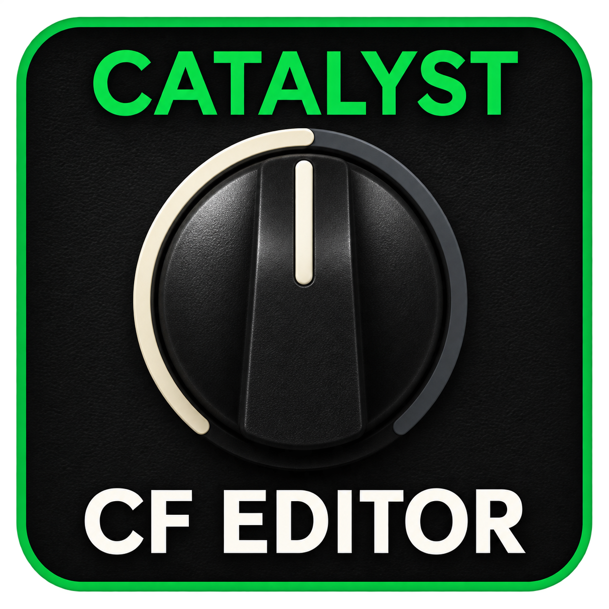

# Catalyst CF Editor

**Español** · [English](README.md)

Editor y cargador Windows para ejecutar **NAM A2 Lite e IR dentro del Catalyst**.
Una aplicación reúne la edición del sonido y la transferencia de recursos;
el audio se procesa en el amplificador.

**v1.0 en revisión privada.** Esta rama prepara la publicación. La
[sección Releases](https://github.com/conr4d86/CatalystIR/releases) conserva
las descargas anteriores; el nuevo **CatalystCFEditor.exe** se publicará tras
la revisión final. La [documentación de CatalystIR 2.0](README-CatalystIR-2.0.md)
sigue disponible.

## Una app, dos tareas

- **Editar el sonido:** amplificador/NAM, Gain, ecualización, volumen, puerta
  de ruido, parámetros avanzados, dos efectos con PRE/POST, presets y sistema.
- **Gestionar recursos:** **IR1/IR2/IR3** y **NAM 1/NAM 2** desde **FIRMWARE CF**.

Tras instalar una vez el CF compatible, **Cambiar NAM / IR** permite sustituir
una posición por USB conservando las demás, sin reinstalar todo el firmware
con cada archivo. Las revisiones del propio motor sí pueden requerir firmware.

El preamp reúne **Boost de fábrica, EP Boost, 808 y SD-1**, con Drive, Level,
Tone y ON/OFF. EP añade Boost/Bright. Son aproximaciones propias basadas en
circuitos documentados, no algoritmos de POD Go. Los controles adicionales
requieren una posición NAM y el CF compatible. Level está antes del NAM y
puede cambiar la saturación además del volumen.

## Cargar una captura o un IR

Con el CF compatible ya instalado:

1. Conecta desde **SONIDO** para comprobar el modelo.
2. Abre **FIRMWARE CF → Cambiar NAM / IR → Comprobar receptor**.
3. Elige la posición y arrastra el archivo, o usa **Cargar NAM… / Cargar IR…**.
4. Revisa nivel y filtros, pulsa **Enviar al ampli** y espera la confirmación.

Vuelve a **SONIDO** para editar. La app cierra los datos antes de recuperar
el editor. Mantén cerrados los otros editores y gestores de Line 6.

Admite **NAM A2 Lite, mono y 48 kHz**; otras arquitecturas no se convierten
automáticamente. Los IR decodificables se adaptan al formato interno cuando
hace falta y el original se conserva. Los perfiles nuevos usan cortes
ajustables de **80 Hz / 8 kHz** y volumen automático o manual.

[Uso](docs/CF_EDITOR_USO.md) · [Preguntas frecuentes](docs/CF_EDITOR_FAQ.md) ·
[Recuperación](docs/CF_EDITOR_RECUPERACION.md) · [Validación](docs/CF_EDITOR_VALIDATION.md)

## Estado de las pruebas

Probado en una unidad Catalyst 60/CX60 con base 2.02. El usuario confirmó
arranque, sonido, carga NAM por USB y una valoración positiva de la revisión
tonal. EP, 808 y SD-1 mantuvieron NAM 2 activo sin nuevos retrasos durante
las mediciones cortas. La revisión manual del guardado y la distribución
nuevos está pendiente.

Los modelos 100/200 están contemplados por el código, pero **no se han probado
físicamente**. No es una certificación general ni una garantía para todos los
ajustes y escenarios.

## Compartir y colaborar

El paquete final de código/compilación y las capturas acompañarán a la versión
aprobada. Esta rama documental no incluye presets personales, capturas comerciales,
IR del usuario ni registros de dispositivos. El EXE no está firmado digitalmente.

Desarrollado por **conr4d**. Proyecto independiente, sin afiliación oficial con Line 6.

[GitHub](https://github.com/conr4d86/CatalystIR) ·
[Invítame a un café](https://buymeacoffee.com/conr4d)
