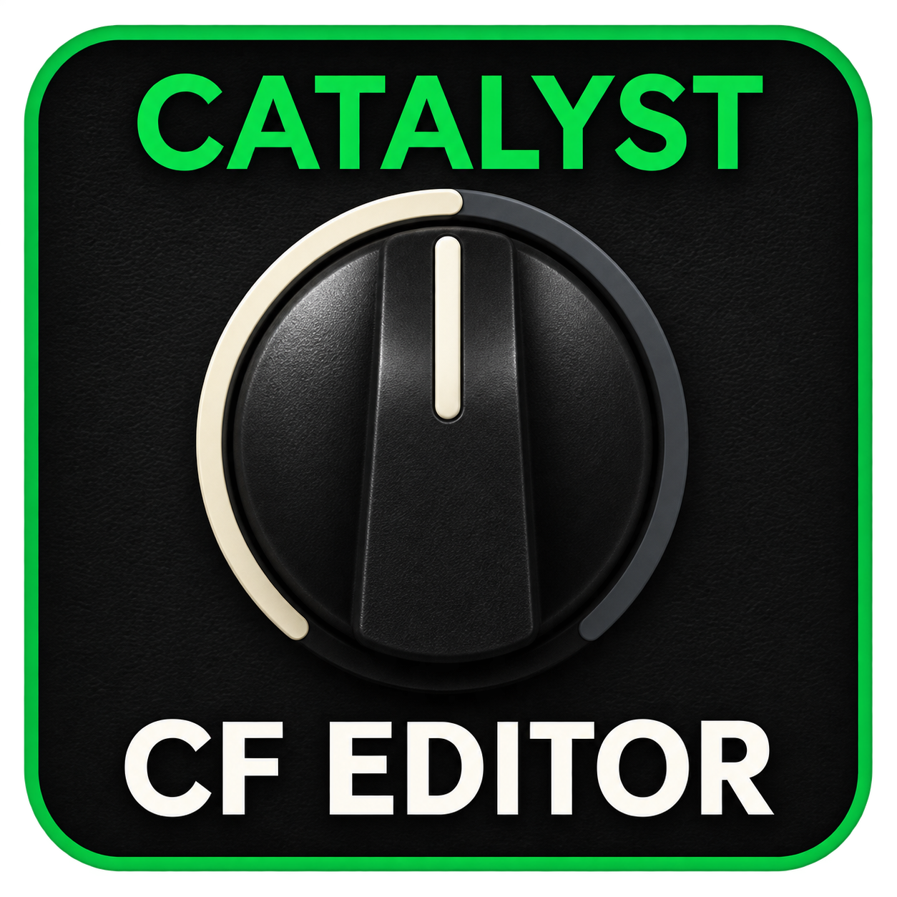

# Catalyst CF Editor

[Español](README.es.md) · **English**

A Windows editor and loader for **NAM A2 Lite and cabinet IR processing
inside the Catalyst amplifier**. Edit the sound and update resources from one
application; the amplifier processes audio independently of the computer.

**Version 1.0 is under private review.** This branch prepares the next release.
The [Releases page](https://github.com/conr4d86/CatalystIR/releases) currently
contains earlier CatalystIR downloads. The new **CatalystCFEditor.exe** will
follow final user review. [CatalystIR 2.0 documentation](README-CatalystIR-2.0.md)
remains available.

## One app, two jobs

- **Sound editing:** amplifier/NAM, Gain, EQ, volume, noise gate, advanced
  parameters, two effects with PRE/POST, presets and system settings.
- **Resource management:** three **IR1/IR2/IR3** positions and two **NAM 1/NAM 2**
  positions in **FIRMWARE CF**.

Install compatible CF once. Afterwards, **Cambiar NAM / IR** updates one position
over USB while preserving the others. A different capture does not require a
complete firmware reinstall. Audio-engine revisions can require new firmware.

The preamp provides **Factory Boost, EP Boost, 808 and SD-1**, with Drive,
Level, Tone and ON/OFF. EP adds Boost/Bright. These are original circuit-informed
approximations, not POD Go algorithms. Extended pedal controls require a NAM
position and compatible CF. Level is before NAM and can change saturation.

## Upload a capture or IR

With compatible CF already installed:

1. Connect from **SONIDO** to verify the amplifier model.
2. Open **FIRMWARE CF → Cambiar NAM / IR → Comprobar receptor**.
3. Choose a position and drop a file, or use **Cargar NAM… / Cargar IR…**.
4. Review levels and filters, click **Enviar al ampli**, and wait for confirmation.

Return to **SONIDO** to edit. The app closes the data connection before
reconnecting the editor. Close other Line 6 editors/managers while using it.
The current app interface is Spanish; instructions retain its actual labels.

Supported NAMs are **A2 Lite, mono, 48 kHz**. Other architectures are not
automatically converted. Decodable IR files are adapted to the internal format
when needed, preserving the original. New IR profiles use adjustable **80 Hz /
8 kHz** cuts and automatic or manual level.

[Usage](docs/CF_EDITOR_USO.md) · [FAQ](docs/CF_EDITOR_FAQ.md) ·
[Recovery](docs/CF_EDITOR_RECUPERACION.md) · [Validation](docs/CF_EDITOR_VALIDATION.md)

## Test status

Tested on one Catalyst 60/CX60 with a 2.02 base. The user confirmed boot,
sound, NAM uploads over USB and a positive listening result with the revised
pedal engine. Short observations with NAM 2 active added no late blocks for
EP, 808 or SD-1. Manual retesting of the app's save/layout update is pending.

100/200 family handling exists in code, but these models **have not been
tested on physical units**. This is not a general compatibility certification
or a guarantee for every setting and use case.

## Share and contribute

The final source/build package and screenshots will accompany the approved
release. This documentation branch includes no user presets, commercial captures,
IR files or device logs. The Windows EXE is not digitally signed.

Developed by **conr4d**. Independent project, not officially affiliated with Line 6.

[GitHub](https://github.com/conr4d86/CatalystIR) ·
[Buy me a coffee](https://buymeacoffee.com/conr4d)
